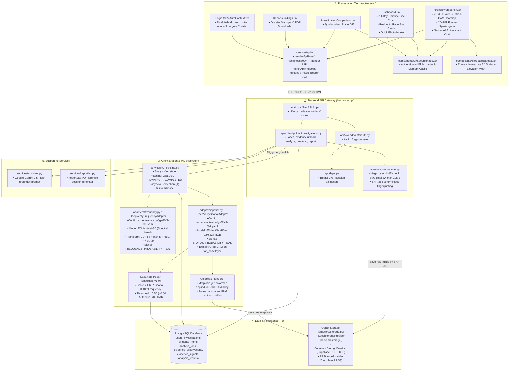

# DeepVerify System Architecture (V2 Production)

> **Notice**: For the full, granular specification with sequence traces and mathematical formulations, see [SYSTEM_ARCHITECTURE.md](file:///home/shairkhan-faizan/Documents/College/SEM5%20MINI%20PROJECT/DeepVerify/docs/SYSTEM_ARCHITECTURE.md).

---

## 1. Concrete System Architecture Diagram

---

## 2. Key Architecture Principles Implemented in Code

1. **Dual-Domain Evaluation**:
   - Spatial evaluation evaluates pixel-space artifacts (blending lines, facial irregularities, anatomical flaws) using `EfficientNet-B0`.
   - Frequency evaluation applies **2D Fast Fourier Transform** to expose periodic noise fingerprints in the frequency spectrum left by diffusion and GAN upsamplers.
2. **Cryptographic Provenance**:
   - Every uploaded image is immediately hashed using SHA-256 (`file_hash`) during input validation. The raw file is stored using this immutable key.
3. **Decoupled Object Storage**:
   - `StorageInterface` allows zero-code switching between Local Storage, Supabase (1 GB free persistent tier), and Cloudflare R2.
4. **Dual-Mode Client Authentication**:
   - The React client supports both cross-origin `Authorization: Bearer <token>` in `localStorage` and `HttpOnly` cookie authentication.
5. **Grounded Explainability**:
   - Instead of unguided AI generation, the AI Assistant receives the deterministic image observations (dimensions, format, color mode), spatial probability, and frequency probability before responding.
