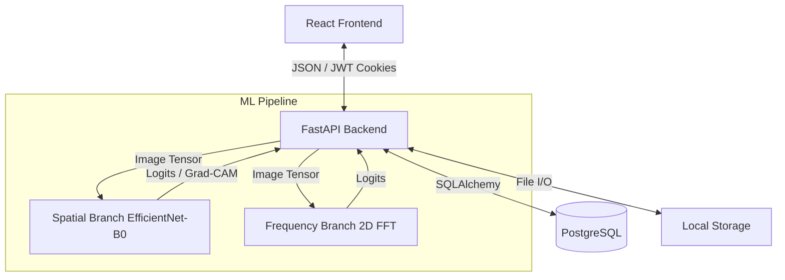

# DeepVerify System Architecture

This document describes the boundaries, data flow, and components of the DeepVerify V2 platform.

## System Context

DeepVerify is structured as a decoupled client-server architecture:
1. **Client (Frontend)**: A React Single-Page Application (SPA) providing the investigator's UI.
2. **API (Backend)**: A FastAPI Python service providing REST endpoints, orchestration, and business logic.
3. **Database**: PostgreSQL for relational entity persistence.
4. **Storage**: Local filesystem for raw binary artifacts (evidence images, Grad-CAM heatmaps).
5. **Inference Pipeline**: In-memory PyTorch/ONNX models executed by the FastAPI backend worker threads.

## Component Boundaries & Data Flow

## Lifecycle and Orchestration

### 1. Authentication and Authorization
- Users authenticate via the `POST /api/v2/auth/login` endpoint.
- The backend issues a stateless `access_token` (JWT) and sets it securely as an `HttpOnly` cookie.
- Every protected route requires this cookie. Authorization is strictly enforced per-resource (e.g., `investigation.user_id == current_user.id`).

### 2. Evidence Upload & Ownership
1. An investigator creates an `Investigation` (Case).
2. Images are uploaded via `POST /api/v2/investigations/{id}/evidence`.
3. The API validates the file (MIME type, size limits), hashes the payload (SHA-256), and assigns a UUID (`storage_key`).
4. The binary is written to the Local Storage under the `storage_key`, immune to path-traversal.
5. An `EvidenceItem` record is created in PostgreSQL with `status="UPLOADED"`.

### 3. Analysis Pipeline
1. Uploading triggers an `AnalysisJob` (`status="QUEUED"`).
2. A background task or synchronous worker executes the ML pipeline (defined by an `AnalysisPolicy`, such as `ensemble-v1.0`).
3. The pipeline routes the image tensor to the necessary branches.
4. Results are combined into an `ensemble_score`.
5. The `AnalysisResult`, `EvidenceSignal`s, and `EvidenceObservation`s are persisted.
6. The `EvidenceItem` status transitions to `COMPLETED` (or `FAILED` on exception).

### 4. Retrieval and Reporting
- **Dashboard & Compare**: The UI fetches aggregated case data and individual evidence metadata.
- **Secure Image Retrieval**: The UI fetches raw images/heatmaps via `GET /api/v2/investigations/evidence/{id}/file`. The backend validates session ownership before streaming the bytes.
- **Forensic PDF Reports**: Triggering a report download requests the backend to query all case data, compile a vector PDF using `reportlab`, and stream it back to the client. No client-side HTML rendering is used for the official export.
