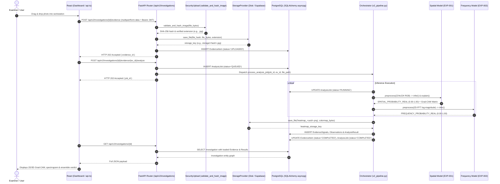

# DeepVerify System Architecture Specification

This document provides the authoritative, source-code-verified architecture of the **DeepVerify** platform, reflecting the actual implementation in the repository across frontend, backend, ML inference, databases, and external services.

---

## 1. Concrete System Architecture Diagram

```mermaid
flowchart TD
    %% ==========================================
    %% 1. PRESENTATION TIER
    %% ==========================================
    subgraph TIER1 ["1. Presentation Tier (frontend/src/)"]
        subgraph UI_Pages ["Client Views & Workstations"]
            P_Dash["Dashboard.tsx\n• 14-Day Timeline Line Chart\n• Real vs AI Ratio Stat Cards\n• Drag-and-Drop Photo Intake"]
            P_Bench["ForensicWorkbench.tsx\n• 2D & 3D WebGL Grad-CAM Heatmap Viewer\n• 2D-FFT Fourier Spectrogram\n• Grounded AI Assistant Chat Tab"]
            P_Comp["InvestigationComparison.tsx\n• Synchronized Side-by-Side Photo Diff"]
            P_Repo["ReportsFindings.tsx\n• Dossier Manager & PDF Downloader"]
            P_Auth["Login.tsx & AuthContext.tsx\n• Dual Auth: dv_auth_token in localStorage + Cookies"]
        end

        subgraph Client_Net ["Client Networking & Services"]
            API_TS["services/api.ts\n• resolveApiBase(): localhost:8000 ↔ Render URL\n• fetchApi(endpoint, options): Injects Bearer JWT\n• Handles FormData multipart & ApiError"]
            SecImg["components/ui/SecureImage.tsx\n• Authenticated Blob Loader & Memory Cache"]
            ThreeD["components/ThreeDHeatmap.tsx\n• Three.js Interactive 3D Surface Elevation Mesh"]
        end
    end

    %% ==========================================
    %% 2. API & SECURITY GATEWAY
    %% ==========================================
    subgraph TIER2 ["2. Backend API & Gateway (backend/app/)"]
        FastAPI_App["main.py (FastAPI App)\n• Lifespan: loads models & adapters\n• CORSMiddleware (origin regex matching)"]

        subgraph Routers ["REST API v2 Endpoints (api/v2/endpoints/)"]
            R_Auth["auth.py\n• POST /api/v2/auth/login\n• POST /api/v2/auth/register\n• GET /api/v2/auth/me"]
            R_Inv["investigations.py\n• POST /api/v2/investigations/ (create case)\n• GET /api/v2/investigations/ (list cases)\n• POST /api/v2/investigations/{id}/evidence (upload)\n• POST /.../evidence/{ev_id}/analyze (trigger ML)\n• GET /.../evidence/{ev_id}/heatmap (download)\n• GET /.../evidence/{ev_id}/spectrum (download)\n• POST /.../evidence/{ev_id}/assistant (query)\n• GET /api/v2/investigations/{id}/report (PDF)"]
        end

        subgraph Core_Sec ["Security & Hardening (core/)"]
            SecUp["core/security_upload.py : validate_and_hash_image()\n• Magic bytes inspection via filetype\n• Rejects SVG scripts (anti-XSS)\n• Caps size at 10 MB & resolution at 4096px\n• Generates deterministic SHA-256 hex string"]
            Deps["api/deps.py : get_current_user()\n• Validates Bearer JWT & loads User from DB"]
        end
    end

    %% ==========================================
    %% 3. ASYNC PIPELINE & ORCHESTRATION
    %% ==========================================
    subgraph TIER3 ["3. Analysis Pipeline & Orchestrator (services/v2_pipeline.py)"]
        Sem["get_inference_semaphore()\n• asyncio.Semaphore(1) locks memory"]
        JobRunner["process_analysis_job(job_id, evidence_id, file_path)\n• Updates AnalysisJob status: QUEUED → RUNNING\n• Dispatches image to model adapters via asyncio.to_thread"]
        Ensemble["Ensemble Policy Evaluator (ensemble-v1.0)\n• Weights: 0.60 * Spatial + 0.40 * Frequency\n• Threshold: 0.50 (≥0.50 LIKELY_AUTHENTIC, <0.50 LIKELY_AI_GENERATED)"]
        Colormap["Colormap Renderer\n• Matplotlib 'jet' colormap applied to Grad-CAM array\n• Saves transparent PNG heatmap artifact"]
    end

    %% ==========================================
    %% 4. MACHINE LEARNING & ADAPTER SUBSYSTEM
    %% ==========================================
    subgraph TIER4 ["4. ML Model Adapters (backend/app/adapters/ & ml/)"]
        subgraph Track_Spatial ["Track A: Spatial Domain (EXP-001)"]
            Ad_Spatial["adapters/spatial.py : DeepVerifySpatialAdapter\n• Config: experiments/configs/EXP-001.yaml"]
            M_Spatial["deepverify_ml.inference : SpatialInferenceModel\n• EfficientNet-B0 (IMAGENET1K_V1 fine-tuned)\n• Input: 224x224 RGB Normalized\n• Output: SPATIAL_PROBABILITY_REAL\n• Explain: Grad-CAM on top_conv layer"]
        end

        subgraph Track_Freq ["Track B: Frequency Domain (EXP-002)"]
            Ad_Freq["adapters/frequency.py : DeepVerifyFrequencyAdapter\n• Config: experiments/configs/EXP-002.yaml"]
            M_Freq["deepverify_ml.inference : FrequencyInferenceModel\n• 2D-FFT Transform + fftshift + log(1 + |F(u,v)|)\n• EfficientNet-B0 (Spectral Head)\n• Detects periodic generative grid artifacts\n• Output: FREQUENCY_PROBABILITY_REAL"]
        end
    end

    %% ==========================================
    %% 5. DATA & STORAGE PERSISTENCE
    %% ==========================================
    subgraph TIER5 ["5. Persistence Tier (PostgreSQL & Object Store)"]
        subgraph DB ["PostgreSQL Database (app/db/models.py)"]
            T_Users[("users\nid, email, hashed_password, role")]
            T_Invs[("investigations\nid, user_id, title, notes, status")]
            T_Evs[("evidence_items\nid, investigation_id, file_hash, storage_key, status")]
            T_Jobs[("analysis_jobs\nid, evidence_id, status, error_message")]
            T_Obs[("evidence_observations\nid, evidence_id, signal_type, value")]
            T_Sigs[("evidence_signals\nid, evidence_id, signal_type, value, model_id")]
            T_Res[("analysis_results\nid, evidence_id, policy_id, ensemble_score, verdict, ai_explanation")]
            T_Pol[("analysis_policies\nid, version, weights, decision_threshold")]
        end

        subgraph Storage ["Object Storage (app/core/storage.py)"]
            StoreProv["StorageInterface Provider\n• LocalStorageProvider (backend/storage/)\n• SupabaseStorageProvider (Supabase REST 1GB)\n• R2StorageProvider (Cloudflare R2 S3)"]
        end
    end

    %% ==========================================
    %% 6. SUPPORTING INTELLIGENCE & EXPORT
    %% ==========================================
    subgraph TIER6 ["6. External AI & Export Services"]
        GeminiService["services/assistant.py\n• Google Gemini 2.5 Flash / OpenAI / Anthropic\n• Grounded prompt with spatial/frequency scores & EXIF"]
        PDFService["services/reporting.py\n• ReportLab PDF Canvas Engine\n• Chain-of-custody, SHA-256 fingerprint, heatmap overlay"]
    end

    %% ==========================================
    %% CONNECTIONS & DATA FLOW
    %% ==========================================
    UI_Pages --> API_TS
    P_Bench --> ThreeD
    P_Bench & P_Dash & P_Comp --> SecImg
    SecImg -->|GET /evidence/{id}/download| R_Inv

    API_TS -->|HTTP REST + Bearer JWT| FastAPI_App
    FastAPI_App --> R_Auth & R_Inv
    R_Auth --> Deps
    R_Inv --> SecUp
    SecUp -->|Save raw image by SHA-256| StoreProv
    R_Inv -->|Insert EvidenceItem & AnalysisJob| DB
    R_Inv -->|Trigger Async| JobRunner

    JobRunner --> Sem
    Sem --> Ad_Spatial & Ad_Freq
    Ad_Spatial --> M_Spatial
    Ad_Freq --> M_Freq

    M_Spatial -->|SPATIAL_PROBABILITY_REAL| Ensemble
    M_Spatial -->|Grad-CAM Matrix| Colormap
    M_Freq -->|FREQUENCY_PROBABILITY_REAL| Ensemble

    Colormap -->|Save heatmap PNG| StoreProv
    Ensemble -->|Save signals, observations, results| DB

    R_Inv -->|Evidence context| GeminiService
    R_Inv -->|Compile case findings| PDFService
```

---

## 2. End-to-End Inference Lifecycle Sequence Diagram



---

## 3. Component to Source Code File Mapping

| Component | Exact Repository File Path | Key Classes & Functions |
| :--- | :--- | :--- |
| **Presentation Tier** | `frontend/src/pages/Dashboard.tsx`<br>`frontend/src/pages/ForensicWorkbench.tsx`<br>`frontend/src/pages/InvestigationComparison.tsx`<br>`frontend/src/pages/ReportsFindings.tsx` | `Dashboard`, `ForensicWorkbench`, `InvestigationComparison`, `ReportsFindings` |
| **API Networking** | `frontend/src/services/api.ts` | `resolveApiBase()`, `fetchApi()`, `getAuthHeaders()`, `setAuthToken()` |
| **3D Attention Mesh** | `frontend/src/components/ThreeDHeatmap.tsx` | Three.js WebGL topographic terrain rendering of Grad-CAM activations |
| **Secure Image Stream** | `frontend/src/components/ui/SecureImage.tsx` | `SecureImage` authenticated blob streamer with memory caching |
| **API Application** | `backend/app/main.py` | `app = FastAPI()`, lifespan model loader, dynamic CORS middleware |
| **Authentication Router**| `backend/app/api/v2/endpoints/auth.py` | `login()`, `register()`, `get_me()`, `logout()` |
| **Investigations Router**| `backend/app/api/v2/endpoints/investigations.py` | `create_investigation()`, `upload_evidence()`, `analyze_evidence()`, `download_heatmap()`, `export_report()` |
| **Input Validation** | `backend/app/core/security_upload.py` | `validate_and_hash_image()` (MIME magic bytes, SVG script-block, resolution/size caps, SHA-256) |
| **Pipeline Runner** | `backend/app/services/v2_pipeline.py` | `process_analysis_job()`, `_run_v2_inference()`, `get_inference_semaphore()` |
| **Spatial Model Adapter**| `backend/app/adapters/spatial.py`<br>`experiments/configs/EXP-001.yaml` | `DeepVerifySpatialAdapter`, `SpatialInferenceModel` (`EfficientNet-B0`), Grad-CAM extractor |
| **Frequency Model Adapter**| `backend/app/adapters/frequency.py`<br>`experiments/configs/EXP-002.yaml` | `DeepVerifyFrequencyAdapter`, `FrequencyInferenceModel` (2D-FFT log-magnitude spectrum) |
| **Storage Abstraction** | `backend/app/core/storage.py` | `StorageInterface`, `LocalStorageProvider`, `SupabaseStorageProvider`, `R2StorageProvider` |
| **Database Models** | `backend/app/db/models.py` | SQLAlchemy models: `User`, `Investigation`, `EvidenceItem`, `AnalysisJob`, `EvidenceObservation`, `EvidenceSignal`, `AnalysisResult`, `AnalysisPolicy` |
| **AI Assistant** | `backend/app/services/assistant.py` | Google Gemini 2.5 Flash grounded prompt injection with forensic metadata |
| **Forensic PDF Export** | `backend/app/services/reporting.py` | `reportlab` document builder compiling audit-proof PDF dossiers with cryptographic checksums |

---

## 4. Key Mathematical & Algorithmic Formulations

### A. Frequency Domain Transformation (EXP-002)
For an input 2D image $f(x, y)$ of size $M \times N$:
$$F(u, v) = \sum_{x=0}^{M-1} \sum_{y=0}^{N-1} f(x, y) e^{-j 2\pi \left(\frac{ux}{M} + \frac{vy}{N}\right)}$$
The zero-frequency component is centered using quadrant swapping (`fftshift`), and the compressed log-magnitude spectrogram is extracted:
$$S(u, v) = \log\left(1 + |F_{\text{shifted}}(u, v)|\right)$$
This exposes high-frequency grid artifacts and spectral signatures characteristic of generative upsampling and transposed convolutions.

### B. Spatial Explainability: Grad-CAM (EXP-001)
For class $c$ and feature activation maps $A^k$ of the final convolutional layer (`top_conv` in EfficientNet-B0):
$$\alpha_k^c = \frac{1}{Z} \sum_{i} \sum_{j} \frac{\partial Y^c}{\partial A_{i, j}^k}$$
$$L_{\text{Grad-CAM}}^c = \text{ReLU}\left(\sum_{k} \alpha_k^c A^k\right)$$
The activation heatmap is interpolated to the input image size, mapped through the Matplotlib `jet` colormap, and exported as a transparent RGBA PNG.

### C. Ensemble Decision Policy (`ensemble-v1.0`)
$$\text{Score}_{\text{ensemble}} = (w_{\text{spatial}} \times P_{\text{spatial}}) + (w_{\text{freq}} \times P_{\text{freq}}) = (0.60 \times P_{\text{spatial}}) + (0.40 \times P_{\text{freq}})$$
$$\text{Verdict} = \begin{cases} \text{LIKELY\_AUTHENTIC} & \text{if } \text{Score}_{\text{ensemble}} \ge 0.50 \\ \text{LIKELY\_AI\_GENERATED} & \text{if } \text{Score}_{\text{ensemble}} < 0.50 \end{cases}$$
